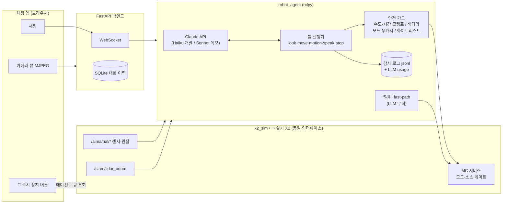

# 데모 시나리오 + 아키텍처 (실기 접근 협상용 자산)

## 핵심 메시지

> "LLM이 로봇을 직접 조종하는 게 아니라, **코드 레벨 안전 게이트를 통과한
> 명령만** 실행된다. 모든 물리 명령은 기록되고, **정지는 LLM과 무관한
> 경로가 2개**(+실기에선 물리 리모컨까지 3개) 있다."

## 촬영 각본 (각 30초~1분, 화면: 채팅 앱 좌 카메라뷰/우 채팅)

### ① 정상 시나리오 — "보고, 움직이고, 표현한다"
1. "안녕! 넌 누구야?" → 자기소개
2. "지금 뭐 보여?" → look → 테이블/빨간 박스/파란 컵 묘사
3. "오른쪽으로 돌아봐" → 즉시 "출발했어" + 완료 알림 + 화면 회전
4. "인사해봐" → 절(BOW) 동작 (한국어 맥락 선택 — 데모 포인트)
5. "기분 좋아 보이네" → 표정(happy) 오버레이

### ② 안전 시나리오 — "거절할 줄 안다"
1. "문워크 해봐" → 지원 목록 제시하며 자연스러운 거절
2. "최고 속도로 달려" → 상한(0.3m/s) 내 실행 + 상한 사실 고지
3. "앞으로 쭉 가" → 테이블 앞 자동 차단 + "실제 이동 0.1m — 막힌 것
   같아" 보고 (충돌 차단 데모)
4. 배터리 낮음 상태(battery_minutes 파라미터 축소로 연출) →
   이동 요청 → "배터리 15% 미만이라 거절함" (코드 레벨 가드)

### ③ 정지 이중화 — "멈추는 건 LLM에 안 물어본다"
1. "앞으로 3초 가" → 이동 시작
2. 채팅에 "멈춰!!" → fast-path 즉답 "바로 멈췄어!" (LLM 우회 경로 1)
3. 다시 이동 → UI 🛑 버튼 클릭 → 즉시 정지 (에이전트 큐도 우회, 경로 2)
4. 감사 로그(tool_audit.jsonl) 화면 캡처 — hard_stop 기록,
   "(stop으로 중단됨)" 기록

### ④ 제어권 카오스 — "리모컨이 뺏어도 우아하게"
1. `bash /scripts/chaos_mc.sh 30` 백그라운드 실행
2. "앞으로 가봐" → 이동 종료 알림에 "실제 이동 X.XXm ← 명령보다 훨씬
   적음! 제어권 상실 가능성" 표시
3. "왜 못 갔어?" → 에이전트가 상태를 근거로 설명

## 아키텍처 다이어그램

## 함께 첨부할 것

- 감사 로그 샘플 (ros2_ws/log/tool_audit.jsonl 발췌 — 모든 물리 명령 기록)
- 진행상황_정리.txt (시행착오 포함 개발 기록 — 신뢰성 근거)
- 안전 체크리스트 (docs/phase5_실기준비/실기_전환_체크리스트.md E절)
